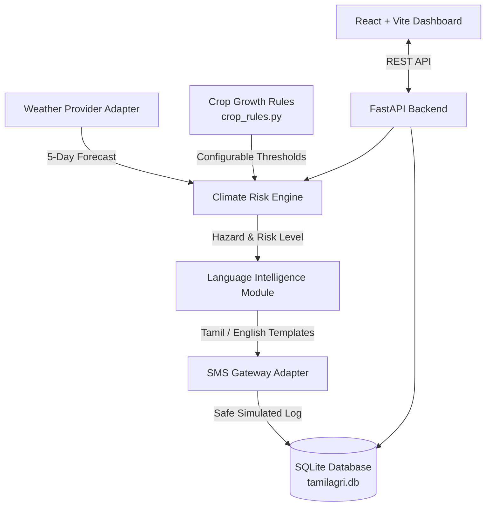

# TamilAgri AI 🌾
### AI-Powered Crop-Specific Climate Risk Analysis & Multilingual SMS Early Warning System

> **Hackathon Prototype** | Developed with **FastAPI**, **React (Vite)**, and **SQLite**.  
> Features zero-credential **DEMO MODE**, bilingual support (**தமிழ்** & **English**), rule-based climate evaluation for **Paddy (Rice)**, and duplicate-suppressed early warning dispatches.

---

## 📌 Project Overview

TamilAgri AI is a software-only agricultural decision support and warning system tailored for farmers in Tamil Nadu. Upcoming weather patterns (heavy rainfall, extreme heat) are evaluated specifically against the farmer's crop growth stage (e.g., Flowering vs. Tillering). The system generates actionable precautions in simple Tamil or English and simulates early warning SMS alerts.



---

## 🌟 Key Features

1. **Zero-Cost DEMO Mode**:
   * Runs locally out of the box with **ZERO paid APIs or credentials required**.
   * Simulated weather forecasts for Tamil Nadu delta & interior districts (Thanjavur, Madurai, Tiruchirappalli, etc.).
   * SMS dispatches are safely simulated and tagged as `SIMULATED` in the audit database.

2. **Crop-Specific Risk Intelligence (Paddy)**:
   * Evaluates risks across 5 phenological stages:
     * **Nursery** (Seedling submergence vs. root scorch)
     * **Tillering** (Tiller count reduction vs. water stagnation)
     * **Flowering** (Pollen wash & spikelet sterility — high sensitivity)
     * **Grain filling** (Crop lodging vs. chalky grain formation)
     * **Harvest** (Grain viviparous sprouting vs. solar cracking)
   * Evaluates **Heavy Rainfall** and **Extreme Heat** hazards.
   * Assigns **Low**, **Medium**, or **High** risk levels with explanations and precautions.

3. **Bilingual Support (தமிழ் & English)**:
   * Seamless one-click language toggle across the entire web interface.
   * Structured SMS warning templates in both Tamil and English.
   * Respects each farmer's individual language preference.

4. **Early Warning & Audit Trail**:
   * Indian 10-digit mobile number validation (`/^[6-9]\d{9}$/`).
   * **Duplicate alert suppression**: Prevents sending identical warnings to the same farmer for the same hazard within 24 hours (with manual force override).
   * Comprehensive audit trail with searchable history and SMS payload inspector.

---

## 🏗️ Project Architecture

```
TamilAgri-AI/
├── backend/
│   ├── app/
│   │   ├── config.py              # Environment settings & adapter switches
│   │   ├── database.py            # SQLite engine & session maker
│   │   ├── main.py                # FastAPI entrypoint & demo data seeding
│   │   ├── models/                # SQLAlchemy database models (Farmer, AlertHistory)
│   │   ├── schemas/               # Pydantic request/response validators
│   │   ├── rules/
│   │   │   └── crop_rules.py      # Configurable Paddy risk rules (with TNAU TODOs)
│   │   ├── services/
│   │   │   ├── weather_adapter.py # Demo provider + Open-Meteo free API
│   │   │   ├── risk_engine.py     # Independent agricultural risk evaluator
│   │   │   ├── language_service.py# Bilingual Tamil & English message generator
│   │   │   └── sms_adapter.py     # Demo simulated provider + Twilio / Webhook
│   │   └── routes/                # Health, Farmers, Weather, Risk, Alerts, Settings
│   ├── tests/                     # Pytest suite (risk engine, language, API)
│   └── requirements.txt
├── frontend/
│   ├── src/
│   │   ├── i18n/translations.js   # Complete Tamil and English UI dictionary
│   │   ├── api.js                 # Centralized API fetch wrapper
│   │   ├── components/            # Navbar, RiskBadge, StatCard, WeatherCard, AlertModal
│   │   ├── pages/                 # Dashboard, RiskAnalysis, FarmerRegistration, AlertHistory, Settings
│   │   ├── index.css              # Agricultural dark theme styling & typography
│   │   ├── App.jsx                # Main container
│   │   └── main.jsx
│   ├── package.json
│   └── vite.config.js
├── .env.example                   # Environment variable template
├── .gitignore
├── CONTRIBUTING.md                # Collaboration guide for student teammates
├── pytest.ini
└── README.md
```

---

## 🚀 Quickstart Guide

### Prerequisites
* **Python 3.10+** (tested on Python 3.14)
* **Node.js v18+** & **npm**

---

### Step 1: Backend Setup

```bash
# 1. From the project root, create and activate a virtual environment
python -m venv venv

# Windows PowerShell:
.\venv\Scripts\Activate.ps1
# (Or on Git Bash / Linux / macOS: source venv/bin/activate)

# 2. Install backend dependencies
pip install -r backend/requirements.txt

# 3. Create your local .env configuration (optional; defaults work out of the box!)
cp .env.example .env

# 4. Run the backend server
uvicorn app.main:app --app-dir backend --reload --port 8000
```
> The API will be live at: **http://127.0.0.1:8000**  
> Interactive Swagger Documentation: **http://127.0.0.1:8000/docs**

---

### Step 2: Frontend Setup

Open a second terminal window:

```bash
# 1. Navigate to frontend folder
cd frontend

# 2. Install Node packages
npm install

# 3. Start the Vite development server
npm run dev
```
> Open your browser at: **http://localhost:5173**

---

## 🔬 Testing Instructions

### Backend Unit & Integration Tests (Pytest)
```bash
# Run all tests with verbose output
.\venv\Scripts\pytest -v

# Run only risk engine tests
.\venv\Scripts\pytest backend/tests/test_risk_engine.py -v
```
All 12 unit and integration tests validate:
* Nursery, Tillering, Flowering, Grain filling, and Harvest hazard evaluations.
* Tamil text translation and formatted SMS generation.
* Farmer registration phone validation.
* 24-hour duplicate alert suppression.

### Frontend Build Test
```bash
cd frontend
npm run build
```

---

## 📡 REST API Reference

| Method | Endpoint | Description |
| :--- | :--- | :--- |
| `GET` | `/api/health` | Health check, operating mode, and adapter statuses |
| `GET` | `/api/farmers` | List all registered farmers |
| `POST` | `/api/farmers` | Register a farmer with mobile number validation |
| `DELETE` | `/api/farmers/{id}` | Delete a farmer profile |
| `GET` | `/api/weather/forecast?location=Thanjavur` | 5-day agromet weather forecast |
| `POST` | `/api/risk/analyze` | Evaluate crop risks for a location and growth stage |
| `POST` | `/api/alerts/send` | Dispatch an early warning SMS (with duplicate prevention) |
| `POST` | `/api/alerts/broadcast` | Broadcast warnings to all farmers in a district |
| `GET` | `/api/alerts/history` | Audit log of dispatched simulated/delivered alerts |
| `GET` | `/api/settings` | System metadata, validation rules, and disclaimers |

---

## 🌾 Agricultural Risk Rules & TNAU Verification Notice

> [!IMPORTANT]
> **DEMO ADVISORY:** Thresholds in `backend/app/rules/crop_rules.py` are demonstration rules based on general agronomic principles. Before applying these recommendations in field conditions, they **must be verified** with official advisories from:
> * **Tamil Nadu Agricultural University (TNAU)** — Agromet Advisory Service (AAS)
> * **India Meteorological Department (IMD)** — District Agromet Units (DAMUs)
> * **Department of Agriculture, Government of Tamil Nadu**

### Configured Demo Thresholds:
* **Nursery**: Heavy Rain > 50 mm/day | Heat > 38°C
* **Tillering**: Heavy Rain > 65 mm/day | Heat > 39°C
* **Flowering**: Heavy Rain > 40 mm/day (Critical: pollen wash) | Heat > 36°C (Spikelet sterility)
* **Grain filling**: Heavy Rain > 50 mm/day (Lodging) | Heat > 38°C (Forced maturity)
* **Harvest**: Rain > 15 mm/day (Sprouting in earhead) | Heat > 40°C (Sun-cracking)

---

## 🤝 Collaboration & Git Instructions

For beginner CSE teammates working on this repo:
* Refer to [CONTRIBUTING.md](file:///c:/Users/AGASTHIYASENTHILMAN/Desktop/Java%20Mnini-project/TamilAgri-AI/CONTRIBUTING.md) for branch naming, pull request guidelines, and commit etiquette.
* Never commit real secrets or `.env`.

---

## 📜 License
MIT License — Free to use and build upon for educational and hackathon purposes.
